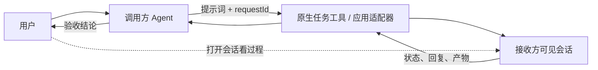

# Agent Call

[中文](#中文) · [English](#english) · [中文详细图解](README.zh-CN.md)

## 中文

Agent Call 是一个 Codex Skill 基座：调用方把提示词送入接收方**独立、可由用户打开的会话**，记录真实会话 ID，随后读取状态和结果。它不绑定特定模型或订阅方案。

**包含内容**

- [`SKILL.md`](SKILL.md)：调用、跟踪与验收规则。
- [通信协议](references/protocol.md)：请求标识、送达回执、终态与异常处理。
- [Antigravity Desktop](references/antigravity.md)：由 Sidecar 调用 `agentapi` 创建或更新原生会话。
- [DSH Web](references/dsh-web.md)：通过当前 Web Host 创建会话、发送消息并收集回复。
- [GrokApp](references/grok-app.md)：向用户已创建的 App 会话续发消息；结果读取的边界见说明。
- [中文详细图解](README.zh-CN.md)：完整流程图与消息示例。

将此文件夹放入 Codex 的 Skills 目录后，可以要求 Codex 使用 `$agent-call` 给指定接收方任务发送一项明确工作。工具返回 `accepted` 只表示受理；是否完成以及产物是否合格，需要继续核对。接收方会话中的可见消息与工具活动由其宿主应用展示，不包括私有内部推理。

## English

Agent Call is a Codex skill base for sending a bounded prompt to a **separate recipient session that the user can open**. It records the real session ID, follows the task, and verifies the result. It does not depend on a particular model or subscription.

The diagram above shows the flow: the caller sends a prompt and `requestId` through a native task tool or adapter; the user opens the recipient session; the caller reads its status and output, then checks the result.

**Included**

- [`SKILL.md`](SKILL.md): dispatch, follow-up, and verification rules.
- [Protocol](references/protocol.md): request IDs, receipts, terminal states, and uncertain delivery.
- [Antigravity Desktop](references/antigravity.md): Sidecar and `agentapi` native conversations.
- [DSH Web](references/dsh-web.md): native Web sessions with prompt and result collection.
- [GrokApp](references/grok-app.md): continuation of an existing App session, with documented result limits.
- [Detailed Chinese guide](README.zh-CN.md): diagrams and message examples.

Place this folder in a Codex skills directory and ask Codex to use `$agent-call` for a specific task and recipient. An `accepted` receipt confirms admission, not completion. Verify the recipient's output and artifacts before reporting success. The recipient app controls what visible progress it displays; private internal reasoning is outside this interface.
