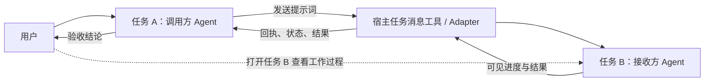
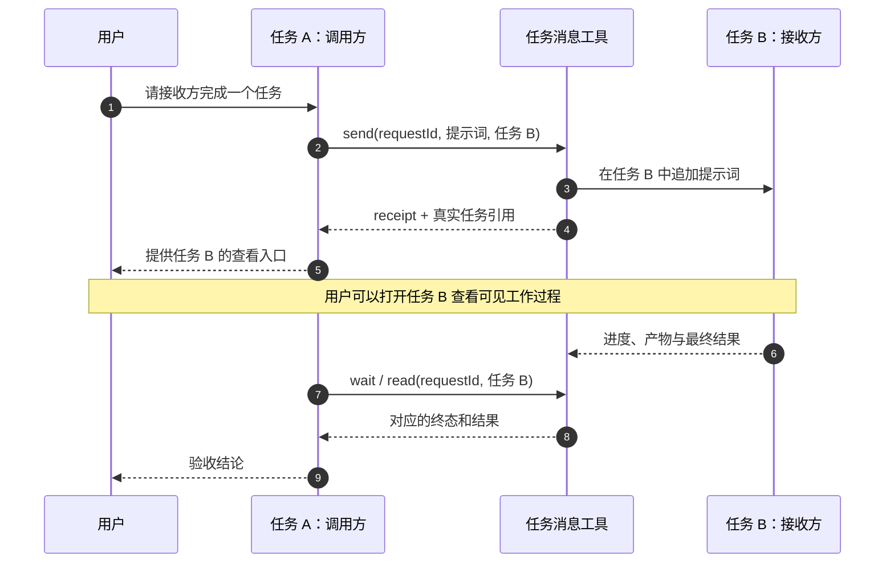
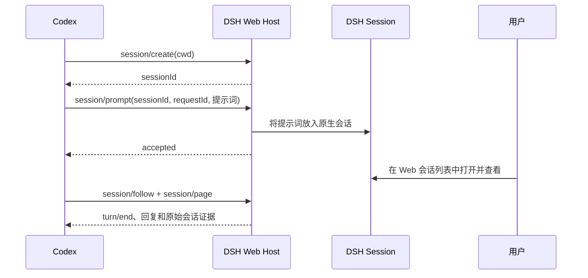

# Agent Call：Agent 之间如何通信

这份说明可直接放入项目 README。图示使用 [GitHub 支持的 Mermaid 代码块](https://docs.github.com/en/get-started/writing-on-github/working-with-advanced-formatting/creating-diagrams)，无需另存图片文件。

目标交互是：**调用方 Agent 把提示词发进接收方 Agent 的独立任务；用户可以打开接收方任务，查看它对用户可见的工作过程；调用方随后读取结果并验收。** 这里的“过程”指会话消息、可见的进度、工具活动和产物，不包括内部推理或私有日志。

## 核心思路

两个 Agent 各有自己的任务会话。调用方通过宿主的任务消息工具，把完整提示词追加到接收方任务；接收方在自己的会话里工作。用户查看接收方会话，调用方负责跟踪终态并核验交付。



工具必须能指向一个用户可打开的接收方任务。后台子 Agent 只把最终答案交回调用方、却没有可查看的独立任务时，无法实现这套展示方式。

| 用户打开的位置 | 能看到什么 |
| --- | --- |
| 任务 A：调用方 | 发给谁、接收方任务入口、调用状态，以及最后的验收结论。 |
| 任务 B：接收方 | 收到的提示词、对用户可见的进度和工具活动、产物与最终回复。 |

## 一次调用如何完成



上图展示的是成功受理的一次调用。用户查看任务 B 的过程不依赖调用方转述；调用方只需等待或读取任务 B 的状态，并在结束后核验结果。任务 B 中具体展示哪些工具事件，由宿主界面决定。

### 三层状态分别代表什么

| 层次 | 示例状态 | 说明 |
| --- | --- | --- |
| 送达 | `accepted` / `rejected` / `unknown` | 工具是否确认接收了请求。`accepted` 不代表 Agent 已完成。 |
| Agent 执行 | `completed` / `failed` / `unknown` | 接收方是否有可确认的原生终态。Agent 自称“完成”仍需核对。 |
| 调用方验收 | `passed` / `failed` / `not_run` | 产物和检查是否符合原任务要求。只有调用方完成这一步，才能说工作已验收。 |

例如，工具返回 `accepted`、接收方返回 `completed`，但测试未通过时，验收仍是 `failed`。这三个状态应分别记录和报告。

## 任务消息长什么样

下面是一条发给**已有接收方任务**的只读审查请求。消息字段可以由适配器发送为 JSON，也可以保留相同信息后通过只接受文本的任务消息工具发送。

```json
{
  "protocol": "agent-call/v1",
  "kind": "request",
  "taskId": "parser-review",
  "attemptId": "1",
  "requestId": "parser-review-1-unique-id",
  "sender": "caller",
  "recipient": "review-agent",
  "recipientTaskRef": "existing-visible-review-task-id",
  "workspace": "/absolute/path/to/project",
  "objective": "检查解析器改动是否引入回归",
  "contextRefs": ["src/parser.py", "tests/test_parser.py"],
  "allowedActions": ["读取相关文件", "运行相关测试"],
  "acceptance": ["报告可定位到文件和行号的问题", "列出实际运行的测试"]
}
```

- `taskId`：整个工作任务的标识，后续讨论同一任务时保持不变。
- `attemptId`：这次执行尝试的标识。
- `requestId`：这次发送的唯一标识；回执、状态查询和结果都要带上它。
- `recipientTaskRef`：接收方的真实任务标识。若用户明确要求新建接收方任务，创建后由工具返回这个标识。
- `contextRefs`：接收方需要查看的上下文位置，避免重复传送整份仓库内容。
- `allowedActions` 与 `acceptance`：说明可做什么，以及交付如何验收。它们表达任务范围；实际访问权限仍由宿主或适配器控制。

发送成功后，回执还应给出真实的 `viewRef`：可以是宿主支持的任务入口或可打开的任务引用。不能为了展示而编造 URL。完整的回执、结果示例和适配器接口见 [通信协议](references/protocol.md)。

## 异常情况下如何处理

**送达不明：**如果发送超时或连接中断，原任务可能已经开始。先用原 `requestId` 查询状态或收集结果；查不到时保留 `unknown` 并等待对账。不能直接换一个新 ID 重发，否则可能让两个 Agent 执行同一任务。

**重复调用：**相同 `requestId` 只能对应相同内容。适配器若支持幂等，可以复用同一回执；若不支持，应明确暴露该限制。新尝试应在上一次尝试已有明确终态后开始。

**共同修改文件：**多个 Agent 可以并行调查，但写同一文件时要先分配独立工作区或唯一写入者。接手前先确认前一位 Agent 是否仍可能写入。

**没有可见的接收方任务：**调用方可以整理好交接消息，但应标记为“未发送”。若需要新建任务，按宿主规则取得用户的明确要求后再创建。

## 在 Codex 任务中的对应方式

Codex App 有[并行任务会话](https://developers.openai.com/blog/run-long-horizon-tasks-with-codex)。以下是当前桌面任务工具的一种映射，具体可用工具以运行技能的宿主为准：

| 动作 | 对应工具或界面 |
| --- | --- |
| 找到已有的任务 B | `list_threads`；确认是目标任务及项目。 |
| 把提示词发到任务 B | `send_message_to_thread`；用户可在任务 B 中看到新消息。 |
| 跟踪任务 B | `wait_threads` 获取状态，必要时用 `read_thread` 读取进度和结果。 |
| 用户查看过程 | 在侧边栏打开任务 B；用户要求打开时可用 `navigate_to_codex_page`。 |
| 新建任务 B | 仅在用户明确要求新任务时使用 `create_thread`，再跟踪返回的真实任务 ID。 |

调用方读取到的状态摘要不等于任务 B 的完整界面。用户要看工作过程，应打开任务 B 本身。

## Codex 发给 Antigravity Desktop 的实现

跨应用时，Codex 的 `send_message_to_thread` 不能直接寻址 Antigravity 会话。此仓库另附一条[Antigravity Sidecar 桥接路线](references/antigravity.md)：Codex 调用本地 `bridge.py create` 创建独立会话，或调用 `bridge.py send` 更新已有会话；Antigravity 托管的 Sidecar 分别执行 `agentapi new-conversation` 和 `agentapi send-message`。用户在 Antigravity Desktop 打开接收会话查看工作过程。可选的 `Stop` Hook 在运行结束时关联会话 ID、终态和 transcript；`bridge.py collect` 据此返回回复。Codex 侧的实时工具进度仍未接入。

这条路线目前只实现**发送和本地回执**。Sidecar 需要使用者在自己的环境中安装、启用，并用真实的专用会话验证桌面实时显示；回执不能证明接收方完成。普通 `agy -p` 可以输出实时 CLI 事件，但不能据此推断原生 Desktop 会自动显示同一任务。

## Codex 发给 DSH Web 的实现

DSH Web 提供了原生 Session 接口。本仓库的 [DSH Web 桥接说明](references/dsh-web.md)和 [`bridge.mjs`](dsh-web/bridge.mjs)展示从 Codex 创建 Web 会话、发送提示词、读取同一会话终态与回复的路径。



桥接只接受当前 Web 进程的正常启动授权 URL，不从浏览器提取 Cookie。`accepted` 不是完成；`worker_finished` 表示 DSH 记录了回合结束，调用方仍要检查产物。桥接返回真实 `sessionId` 和 Web 根地址，目前不编造指定会话的深链接。独立运行的 `dsh-mcp` / headless 任务不等同于当前 Web 页面中的实时任务。

## 适配器最小接口

```text
send(request)                    -> 把提示词发进任务 B，返回任务引用和送达回执
status(recipientTaskRef, requestId)  -> 查询任务 B 的原生状态
collect(recipientTaskRef, requestId) -> 收集任务 B 对应的结果
```

这个接口还必须配合宿主提供的任务查看入口，让用户直接打开任务 B。具体可见内容由宿主界面决定。
