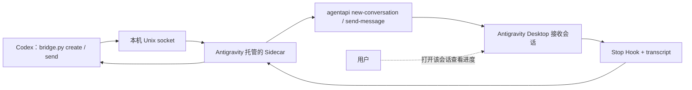

# Codex → Antigravity Desktop：原生会话创建与发送路线

Codex 在终端调用本地客户端，Antigravity 托管的 Sidecar 接收请求，再用 `agentapi new-conversation` 创建独立会话，或用 `agentapi send-message` 给**已有**会话发消息。用户在接收会话里查看 Antigravity 对用户可见的工作过程。

`create` 每次使用新的 `requestId` 创建一条会话；`send` 更新指定会话。创建会话要求 Sidecar 配置了 Antigravity 项目的 `projectId`。同一个 `requestId` 重试不会重复创建或发送。



Google 的 [Sidecars 文档](https://antigravity.google/docs/sidecars)规定：Sidecar 由 Antigravity 管理，`agentapi` 在 Sidecar 的 PATH 中；文档列出 `new-conversation` 和 `send-message`。本机 Antigravity 2.15.0 的 `agentapi --help` 还列有 `get-conversation-metadata`，本示例用它做 `send` 的预检。其他版本若没有这条命令，桥接会拒绝 `send`。`create` 使用 Sidecar 已绑定的项目，不会自动选择或切换项目。

## 为什么不能直接执行普通 CLI

`agy -p "提示词" --output-format stream-json` 是官方支持的[无头 CLI 调用](https://antigravity.google/docs/cli/headless/)：Codex 可以读取实时事件，但官方文档没有说明这会自动成为**本机原生 Desktop** 中的实时任务。[CLI 概览](https://antigravity.google/docs/cli/overview)写的是将 CLI 会话**导出**到桌面版。CLI 的 [Remote Control](https://antigravity.google/docs/remote-control/)则能在**浏览器里的 Antigravity Desktop UI** 实时查看交互式 CLI 会话，这是另一条路线。

`agentapi` 的官方入口是 Sidecar 环境。某些安装虽然有可从普通终端找到的 `agentapi` 包装脚本，直接运行仍可能报告 `ANTIGRAVITY_LS_ADDRESS is not set`。因此本示例让 Antigravity 启动 Sidecar，并由 Sidecar 内部调用 `agentapi`。安装后仍需用专用测试会话验证桌面显示。

## 源码与状态边界

- [`antigravity-sidecar/sidecar.json`](../antigravity-sidecar/sidecar.json)：让 Antigravity 启动桥接进程。
- [`antigravity-sidecar/bridge.py`](../antigravity-sidecar/bridge.py)：同一脚本的 `serve` 模式在 Sidecar 中监听本机 Unix socket；`create`、`send`、`status`、`collect` 模式供 Codex 调用。
- [`antigravity-sidecar/hook.py`](../antigravity-sidecar/hook.py)：可选的 `Stop` Hook 收集器。只处理能与本桥接回执匹配的会话，从 Antigravity 提供的 transcript 中提取最后一条模型回复，并记录 `terminationReason`、`fullyIdle`。
- [`antigravity-sidecar/hooks.example.json`](../antigravity-sidecar/hooks.example.json)：需要合并到用户的 `~/.gemini/config/hooks.json`，并替换其中的绝对脚本路径；不可覆盖已有 Hooks。
- `create` 先写入本地回执，再调用 `agentapi new-conversation`。`send` 先读取已有会话元数据，再写入回执，最后调用 `agentapi send-message`。提示词带 `requestId` 标记，便于在 Desktop 会话中辨认。
- `create` 会尝试从命令返回值或 Sidecar 的 `events/` 文件中提取真实会话 ID。事件文件目录是官方文档列出的运行数据，但其 JSON 字段不是稳定公开接口；提取失败时返回 `CLI_ACCEPTED_NO_REF`，不重复发送。
- 元数据预检只确认该会话可由当前 Sidecar 查询；本示例尚未解析并核对项目、工作区或模型。发送前应人工确认目标会话绑定。
- 同一个 `requestId` 和同一内容复用回执；同 ID 不同内容被拒绝；发送结果不明时保持 `DISPATCH_UNKNOWN`，不会自动重发。
- `CLI_ACCEPTED` 只说明 `agentapi` 命令返回成功。回执中的 `desktopVisibilityVerified` 和 `nativeCompletionVerified` 仍为 `false`。安装 `Stop` Hook 后，`status` 可读到它记录的终态摘要，`collect` 可读取回复；两者都不订阅实时工具进度。若 `fullyIdle` 为 `false`，结果保持 `PENDING_BACKGROUND`。

## 手动接入步骤

以下命令在 **macOS Terminal（zsh）** 中运行。先进入 `agent-call` 源码目录；安装会写入用户级的 `~/.gemini/config/sidecars/`，启用 Sidecar 还会修改 `~/.gemini/config/config.json`。建议先备份现有配置，再将示例字段合并进去。不要直接覆盖整个配置文件。

```zsh
cd /absolute/path/to/agent-call
mkdir -p "$HOME/.gemini/config/sidecars/agent-call"
cp antigravity-sidecar/bridge.py antigravity-sidecar/hook.py \
  antigravity-sidecar/sidecar.json \
  "$HOME/.gemini/config/sidecars/agent-call/"
```

在 `~/.gemini/config/config.json` 现有 JSON 对象的 `sidecars` 字段中合并（保留其他设置）。使用 `create` 时，`projectId` 必须是 Antigravity 中实际项目的 ID：

```json
{
  "sidecars": {
    "agent-call": {
      "enabled": true,
      "projectId": "YOUR_ANTIGRAVITY_PROJECT_ID"
    }
  }
}
```

Antigravity 启动该 Sidecar 后，桥接会在应用提供的数据目录中创建权限为 `0600` 的 Unix socket。Codex 明确指定一个 UTF-8 提示词文件。创建独立会话：

```zsh
python3 antigravity-sidecar/bridge.py create \
  --request-id example-create-001 \
  --prompt-file /absolute/path/to/prompt.txt

python3 antigravity-sidecar/bridge.py status --request-id example-create-001
```

需要让 Codex 在任务结束后自动拿到回复时，按 [Hooks 官方格式](https://antigravity.google/docs/hooks/)将 `hooks.example.json` 的 `agent-call` 字段合并进 `~/.gemini/config/hooks.json`，把 `command` 改成安装后的 `hook.py` **绝对路径**。这是全局 Hook，但脚本只读取与 `agent-call` 回执匹配的会话；它始终返回允许结束的决定，不接管 Antigravity 的审批或控制权。Hook 必须在任务运行前启用；此前的调用不会补发 `Stop` 事件。

```zsh
python3 antigravity-sidecar/bridge.py collect --request-id example-create-001
```

给**真实的已有会话 ID** 发送后续消息：

```zsh
python3 antigravity-sidecar/bridge.py send \
  --request-id example-001 \
  --conversation-id YOUR_EXISTING_CONVERSATION_ID \
  --prompt-file /absolute/path/to/prompt.txt

python3 antigravity-sidecar/bridge.py status --request-id example-001
```

收到 `CLI_ACCEPTED` 后，用户应打开对应的 Antigravity Desktop 会话，确认提示词和后续工作确实出现。先在专用测试项目与会话中验证这一步，再把路线用于实际项目。若 Sidecar 未运行、会话 ID 不匹配或应用不支持该调用，桥接会返回错误或不明送达状态，不会自动改用 `agy -p`。

## 当前未实现的部分

`agentapi` 文档只列出创建会话和发送消息；[Hooks 文档](https://antigravity.google/docs/hooks/)另行提供 `Stop` 事件及 transcript 路径。本示例用 `Stop` 收集终态和最后回复，尚未用 `PostToolUse` 等事件实现 Codex 侧的实时进度流。transcript 的具体 JSONL 步骤字段是在本机 Antigravity 2.15.0 观察到的格式，版本变化可能使回复提取失败；此时保留原生会话供人工核对。`fullyIdle` 和 `terminationReason` 是终态证据，仍需由调用方验收任务产物。不要把本地 `CLI_ACCEPTED` 当成 Desktop 已显示或任务已完成。
