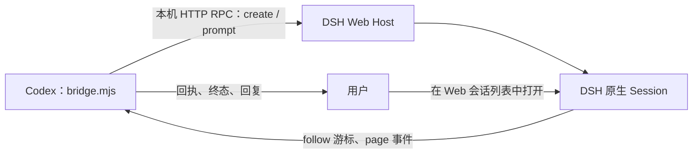

# Codex → DSH Web：向原生可见会话派发

DSH 的 Web Host 已有创建会话、发送提示词和读取会话日志的接口。本仓库的 [`dsh-web/bridge.mjs`](../dsh-web/bridge.mjs) 调用这些接口：创建的是同一个 Web Host 管理的 Session，用户可在 DSH Web 的会话列表中打开它。桥接输出 `sessionId` 和 Web 根地址；目前没有核实可直达指定 Session 的 URL，因此不会编造深链接。



这条路线与独立的 `dsh --profile headless` 或 `dsh-mcp` 不同：后两者由另一个进程运行任务并读取标准输出，不能据此保证当前 Web 页面实时展示同一个执行中的 Session。

## 前提与认证

需要 Node.js 20 以上和正在运行的 DSH Web。进入本目录安装唯一的运行依赖：

```zsh
cd /absolute/path/to/agent-call/dsh-web
pnpm install --ignore-scripts
```

DSH Web 的启动 URL 带进程 token。Host 只在根页面通过该 token 换取签名 Cookie；普通 `http://127.0.0.1:3080/` 请求返回 401 是正常的。桥接支持从 `DSH_WEB_LAUNCH_URL` 环境变量，或从 `--launch-url-file` 指定的**当前进程启动日志**读取 URL。URL 和 Cookie 只在本机内存使用，不写到桥接回执。日志应限制为当前用户可读，不要提交到 Git。

如果启动面板丢弃了 URL，桥接不能凭端口自行登录。应让 Web 启动器安全地保留当前进程的启动 URL；不要从浏览器导出 Cookie，也不要读取 DSH 的签名密钥来伪造会话。

## 创建、发送、收集

以下命令在 macOS Terminal 的 zsh 中执行。`/absolute/path/to/dsh-web.log` 指向当前 Web 进程的受限启动日志；`/absolute/path/to/project` 是接收方会话绑定的工作目录。

```zsh
node bridge.mjs create \
  --launch-url-file /absolute/path/to/dsh-web.log \
  --cwd /absolute/path/to/project

node bridge.mjs send \
  --launch-url-file /absolute/path/to/dsh-web.log \
  --session-id ACTUAL_DSH_SESSION_ID \
  --request-id example-hi-001 \
  --cwd /absolute/path/to/project \
  --prompt hi

node bridge.mjs collect \
  --launch-url-file /absolute/path/to/dsh-web.log \
  --session-id ACTUAL_DSH_SESSION_ID \
  --request-id example-hi-001 \
  --timeout-ms 60000
```

`create` 返回真实 `sessionId`；`send` 先核对该会话的 `cwd`，再调用 `session/prompt`。长提示词可使用 `--prompt-file` 代替 `--prompt`。桥接将 `requestId` 与会话、目录和提示词哈希记在当前目录的 `.agent-call-state/dsh-web/`；同 ID 不同内容会被拒绝，目录可用 `--state-dir` 改到项目私有位置。`accepted` 只表示提示词已受理。`collect` 从同一 Session 的 `session/follow` 取得日志游标，再用 `session/page` 查找对应 `requestId` 的用户消息、回复和 `turn/end`。它返回 `worker_finished`、原生结束原因与回复文本；调用方仍要核验任务产物。超时只报告当前状态，不自动重发。

`requestId` 要稳定且与消息内容绑定。DSH 对同一 Session 中已记录的 `requestId` 有去重逻辑，但调用方仍应先用 `status` / `collect` 对账；不能换 ID 盲目重发。用户在 Web 中可看到 DSH 对用户可见的消息和工具活动，桥接侧目前只收集持久事件与最终文本，不转播实时工具流，也不读取内部推理。

## 可见性边界

桥接读取的 `session/list` 能证明会话属于当前 Web Host；`session/page` 能证明消息和回复进入该会话。是否已经在用户当前打开的浏览器标签中显示，仍需用户直接查看 DSH Web。若 Web 服务重启，使用新进程生成的启动 URL；浏览器中已有的签名 Cookie 通常可保留，但桥接不依赖浏览器 Cookie。
