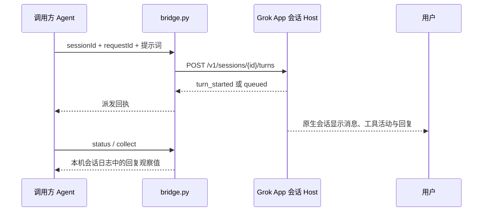

# Grok App 可见会话适配器

Grok App 提供受令牌保护的本机 Session API。这个适配器把提示词送进**已有的 Grok App 会话**，用户可在 Grok App 中查看该会话的原生过程。它不会通过独立的 Grok CLI 新开一个与桌面端无关的执行进程。



## 使用条件

1. Grok App 正在运行，且目标会话已在 App 中建立。官方 Session API **不能新建会话**。做联调测试时应先建专用会话，以免污染现有工作。
2. 从 App 侧栏复制会话 ID，作为 `--session-id`。它是 Grok App 会话 ID，不是 Grok Build CLI 的 agent session ID。
3. 调用方与 Grok App 在同一台机器上。适配器只接受 `127.0.0.1` 的本机 API 地址；令牌从 Grok App 的本机 `session-api.json` 读取，不写入源码、回执或命令行。

在 macOS 终端中，进入 `agent-call` 目录后运行：

```sh
python3 grok-app/bridge.py list
python3 grok-app/bridge.py send \
  --session-id '<app-session-uuid>' \
  --request-id 'my-task-attempt-1' \
  --prompt 'hi'
python3 grok-app/bridge.py status --request-id 'my-task-attempt-1'
python3 grok-app/bridge.py collect --request-id 'my-task-attempt-1'
```

实际任务可以续用正确的已有会话；测试提示词应使用专用会话。长提示词可通过 `--prompt-file /absolute/path/to/prompt.txt` 读取。`requestId` 对应 Grok App 的 `idempotencyKey`；同一 ID 加同一内容重复调用时，适配器返回本地回执，不再发送。回执保存在 `~/.local/state/agent-call/grok-app/`，文件权限为仅当前用户可读。若 POST 超时，派发状态为 `unknown`；先检查原会话，不要换 ID 重发。

`turn_started` 只代表 Grok App 已开始一轮；`queued` 代表它已放入忙碌会话的跟进队列。两者都不等于完成。`status` 和 `collect` 会按会话 ID 只读检查该会话的 `sessions/<id>/messages.json`，找出这次提示词以及其后的回复。此文件读取**依赖当前 Grok App 的本地日志格式**，不是官方结果 API；`reply_observed` 只能证明回复已出现在日志中，适配器仍返回 `nativeCompletionVerified: false`。最终完成状态和过程应在 Grok App 原生会话中查看。

非 macOS 环境可以设置 `GROK_APP_DATA_DIR` 指向该平台的 Grok App 数据目录。需要自定义本地回执目录时设置 `AGENT_CALL_GROK_STATE_DIR`。不要把 `session-api.json`、回执或原生会话日志提交到 Git 仓库。

依据：[Grok App Local Session API 文档](https://github.com/RongleCat/grok-app/blob/main/docs/llm-wiki/session-api.md)。
