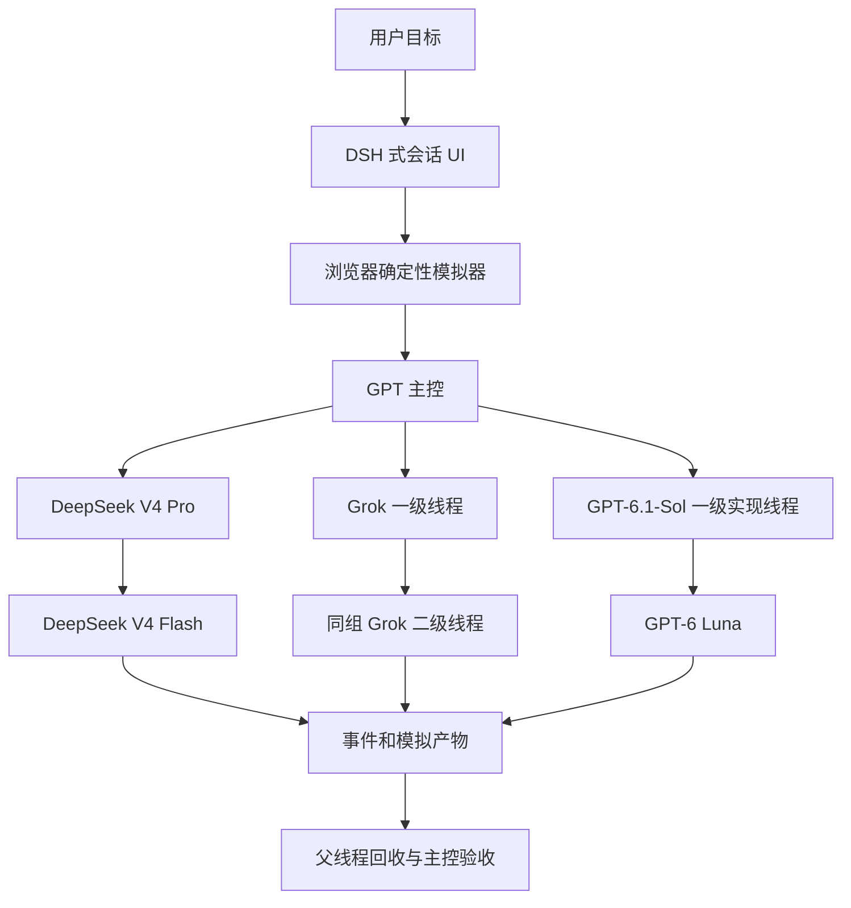

# AI Team V1 架构

V1 的可交付产品是 DSH 式多 Agent 会话工作台：可查看主控与子线程、播放层级派发过程、回收结果并验收。公开页面使用确定性模拟器；仓库同时保留本地 SQLite 控制面，供真实 Agent Call 接入扩展。

三个层级分别是主控 `depth=0`、一级 `depth=1`、二级 `depth=2`。七个线程分别有 `requestId`、父线程和消息记录。模型名称是用户指定的演示配置，网页不查询模型目录，也不执行推理。

## 组件分工

| 组件 | 权威范围 | V1 实现 | 真实接入阶段 |
|---|---|---|---|
| Agent Call | 原生会话寻址、送达、状态与结果收集 | 复用 `agent-call/v1` 的字段和三层事实；原有桥接源码保留 | 复用 `dsh-web/bridge.mjs`、Grok App 和 Antigravity 适配器 |
| DSH | 会话 UI、DeepSeek 执行宿主、同组子线程 | 复用 MIT 主题 CSS，改写三栏会话布局；保留来源声明 | DSH Web 承载可打开的原生 Session；headless 是独立路线 |
| LangGraph | 长任务图、检查点、暂停恢复、人工验收 | 当前没有调用或安装要求 | 作为顶层工作流权威，使用 Agent Call 接口派发与收集 |
| Microsoft Agent Framework | 可选运行时、工具与企业集成 | 当前没有调用或安装要求 | 作为工作节点适配器接入，不与 LangGraph 同时持有顶层状态 |
| Python 控制面 | 本地任务状态与事件账本 | SQLite、CLI、loopback API 与状态门槛 | 作为协议审计投影，保留 provider 与 caller 的独立事实 |

真实接入采用单一顶层编排权威：`LangGraph -> Agent Call -> DSH / Grok / 可选 MAF worker`。DSH 保有自己的原生会话状态；LangGraph 负责跨组流程，SQLite 保存审计投影。状态通过 requestId 关联，避免两套编排系统分别重试同一请求。

## V1 的模块边界

- `web/simulation.js`：七个线程、二十四个步骤、父子约束、同组约束、超时硬停、原请求对账、验收门槛。
- `web/app.js`：线程选择、会话切换、拓扑、事件、产物下载、播放控制与验收交互。没有 fetch、模型调用或凭据读取。
- `web/vendor/`：DSH 原始主题 CSS 与 MIT 许可证；来源提交 `c291e7961a515f6d7af9304e7fd1d257929aef26`。
- `models.py` / `service.py` / `store.py`：本地 API/CLI 控制面，单任务与三层状态。
- `server.py`：loopback 静态资源和控制面 API。公开部署只发布静态资源，不发布该 API。

公开模拟事件保存在当前页面内存中；刷新页面会重置。JSON 导出是浏览器生成的文件，没有上传。当前浏览器模拟记录不会写入 SQLite，SQLite 的 CLI/API 测试是独立证据。

## 完成规则

`simulated delivery`、`worker completed`、`caller passed` 是不同事实：

1. 二级线程完成后，一级线程才可回收与完成。
2. 三个一级线程完成后，主控才可生成最终结果。
3. 最终结果产生后进入 `review`；用户核对三个证据条件后才进入 `accepted`。
4. `unknown` 送达会停止模拟推进；对账继续使用原 requestId，不新增派发。

本地 Python 控制面采用 `planned -> dispatched -> result_observed -> accepted | rejected`；未知送达进入 `delivery_unknown`。V1 的重复派发保护覆盖串行调用。真实并发派发前，需要增加持久化 dispatch claim 和租约，不能把当前串行测试当作并发保障。

## 后续真实接入的最低条件

每个适配器至少提供 `send / status / collect / viewRef`。必须用一个专用、用户可打开的原生会话证明：同 requestId 送达，原生终态对应，结果可收集，调用方检查产物后记录验收。传输回执、HTTP 200 或模型自称完成都不足以通过此阶段。
